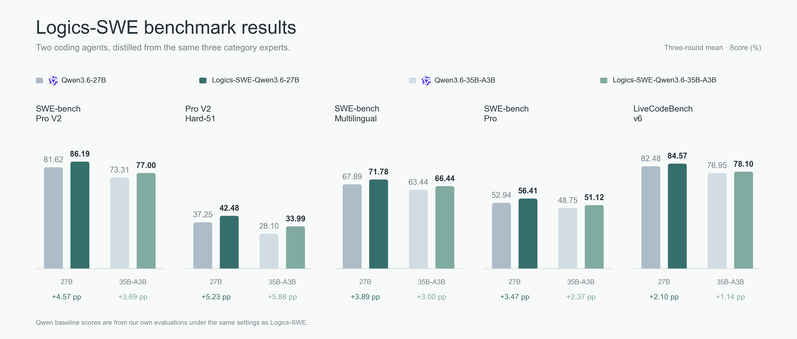
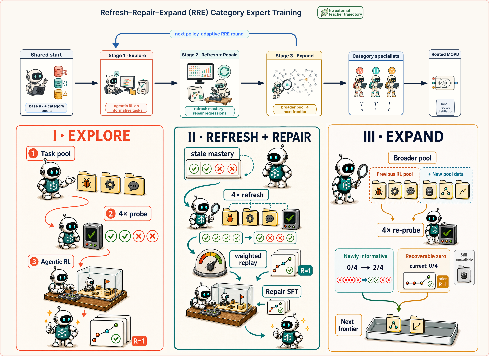
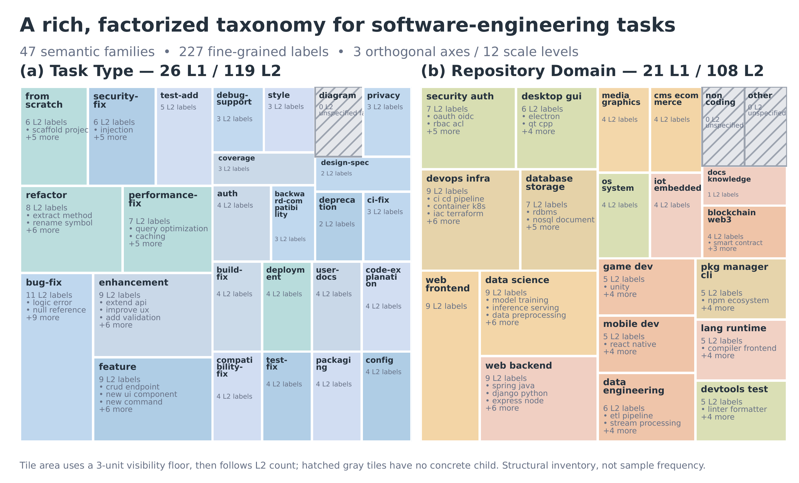
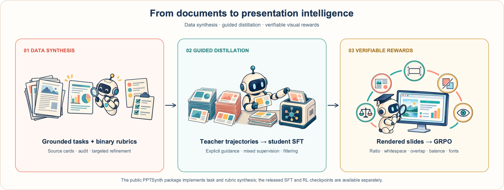
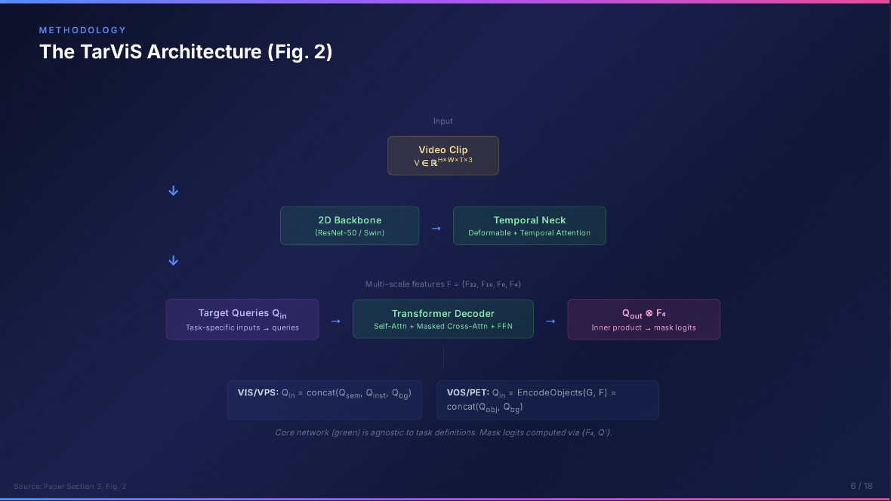
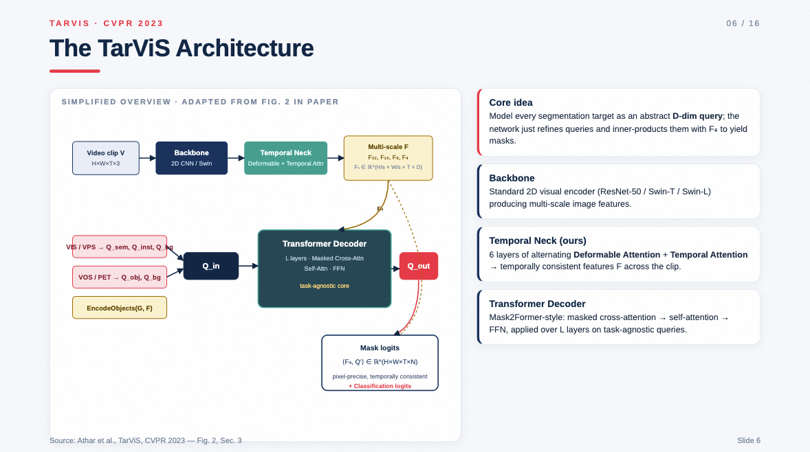

# Agentic Bigbang

**Data, evaluation, and post-training for agents that work.**

Agentic Bigbang brings together our research on agentic data synthesis,
data processing, evaluation, and post-training across two domains:

- **SWE:** agents for repository-level software engineering, from task
  organization and expert training to single-policy integration.
- **Cowork:** agents for knowledge work and productivity tasks, including
  document-grounded slide generation and task-specific evaluation.

This is a shared research repository. Each work has its own documentation,
artifacts, and release scope; reusable tools live alongside the paper packages.

## Latest SWE Results

**Two Logics-SWE models, one set of three category experts.** Our 27B and
35B-A3B students bring category-specific expertise into single-model coding
agents through multi-teacher on-policy distillation (MOPD).

| Model | SWE-bench Pro V2 | SWE-bench Multilingual |
| --- | ---: | ---: |
| [Logics-SWE-Qwen3.6-27B](https://huggingface.co/Logics-MLLM/Logics-SWE-Qwen3.6-27B) | **86.19%** · +4.57 pp | **71.78%** · +3.89 pp |
| [Logics-SWE-Qwen3.6-35B-A3B](https://huggingface.co/Logics-MLLM/Logics-SWE-Qwen3.6-35B-A3B) | **77.00%** · +3.69 pp | **66.44%** · +3.00 pp |

Improvements are over the corresponding Qwen3.6 base model.

See all benchmark scores

| Evaluation | Qwen3.6-27B | Logics-SWE-Qwen3.6-27B | Qwen3.6-35B-A3B | Logics-SWE-Qwen3.6-35B-A3B |
| --- | ---: | ---: | ---: | ---: |
| SWE-bench Pro V2 | 81.62 | **86.19** (+4.57) | 73.31 | **77.00** (+3.69) |
| Pro V2 Hard-51 | 37.25 | **42.48** (+5.23) | 28.10 | **33.99** (+5.88) |
| SWE-bench Multilingual | 67.89 | **71.78** (+3.89) | 63.44 | **66.44** (+3.00) |
| SWE-bench Pro | 52.94 | **56.41** (+3.47) | 48.75 | **51.12** (+2.37) |
| LiveCodeBench v6 | 82.48 | **84.57** (+2.10) | 76.95 | **78.10** (+1.14) |

Scores are percentages; gains are in percentage points.

[Paper](https://arxiv.org/abs/2609.23377) ·
[27B model](https://huggingface.co/Logics-MLLM/Logics-SWE-Qwen3.6-27B) ·
[35B-A3B model](https://huggingface.co/Logics-MLLM/Logics-SWE-Qwen3.6-35B-A3B) ·
[Training data and environments](https://huggingface.co/datasets/Logics-MLLM/Logics-SWE-Env-2.5K) ·
[Evaluation data](papers/rre_mopd/results/expanded_evaluation/README.md) ·
[How it works](#swe-research-rre-mopd)

## Release Timeline

Public releases are listed newest first. Dates are in UTC; future papers,
models, datasets, and tools will be added as they become available.

| Date | Area | Milestone | Links |
| --- | --- | --- | --- |
| 2026-10-30 | SWE · Paper | Submitted the expanded RRE–MOPD paper as arXiv v2, adding broader evaluations and teacher reuse across student architectures | [Paper](https://arxiv.org/abs/2609.23377) |
| 2026-10-30 | SWE · Model | Released **Logics-SWE-Qwen3.6-35B-A3B**, an MoE student distilled from the same three 27B category experts | [🤗 Model](https://huggingface.co/Logics-MLLM/Logics-SWE-Qwen3.6-35B-A3B) · [Model card](papers/rre_mopd/MODEL_CARD_35B_A3B.md) |
| 2026-10-22 | Cowork · Paper | Published *Building Presentation Intelligence for High-Quality Slide Generation* | [arXiv:2610.30888](https://arxiv.org/abs/2610.30888) · [Logics-PPT overview](papers/logics_ppt/README.md) |
| 2026-09-22 | SWE · Cowork | Published the Agentic Bigbang research packages and tools | [RRE–MOPD artifacts](papers/rre_mopd/README.md) · [SWE Labeler](swe_labeler/README.md) · [Logics-PPT overview](papers/logics_ppt/README.md) · [PPTSynth](pptsynth/README.md) |
| 2026-09-21 | SWE · Dataset | Released 2,553 task instances with environment references | [Logics-SWE-Env-2.5K](https://huggingface.co/datasets/Logics-MLLM/Logics-SWE-Env-2.5K) · [Usage guide](papers/rre_mopd/instance_environment/README.md) |
| 2026-09-20 | SWE · Paper | Published *One to More, More to One* | [arXiv:2609.23377](https://arxiv.org/abs/2609.23377) |
| 2026-09-20 | Cowork · Models | Released four Logics-PPT SFT and RL checkpoints | [27B SFT](https://huggingface.co/Logics-MLLM/Logics-PPT-Qwen3.6-27B-SFT) · [27B RL](https://huggingface.co/Logics-MLLM/Logics-PPT-Qwen3.6-27B-RL) · [35B-A3B SFT](https://huggingface.co/Logics-MLLM/Logics-PPT-Qwen3.6-35B-A3B-SFT) · [35B-A3B RL](https://huggingface.co/Logics-MLLM/Logics-PPT-Qwen3.6-35B-A3B-RL) |
| 2026-09-18 | SWE · Model | Released the single-policy Logics-SWE-Qwen3.6-27B | [Model and card](https://huggingface.co/Logics-MLLM/Logics-SWE-Qwen3.6-27B) |

| Domain | Work or component | Entry point |
| --- | --- | --- |
| SWE | **RRE–MOPD:** category-aware expert development and policy integration | [📄 Paper](https://arxiv.org/abs/2609.23377) · [Research artifacts](papers/rre_mopd/README.md) · [🤗 Model](https://huggingface.co/Logics-MLLM/Logics-SWE-Qwen3.6-27B) · [🤗 Data & environments](https://huggingface.co/datasets/Logics-MLLM/Logics-SWE-Env-2.5K) · [Model card](papers/rre_mopd/MODEL_CARD.md) |
| SWE | **SWE Labeler:** hierarchical task and trajectory annotation | [Code and usage](swe_labeler/README.md) |
| Cowork | **Logics-PPT:** data synthesis, guided distillation, and verifiable rewards for presentation generation | [📄 Paper](https://arxiv.org/abs/2610.30888) · [Research overview](papers/logics_ppt/README.md) · [🤗 SFT & RL models](#released-logics-ppt-models) · [ModelScope](#released-logics-ppt-models) |
| Cowork | **PPTSynth:** document-grounded slide-task and rubric synthesis | [Code and usage](pptsynth/README.md) |

## SWE Research: RRE-MOPD

### One to More, More to One: Category-Aware Iterative Expert Training for Software Engineering Agents

[Paper](https://arxiv.org/abs/2609.23377) ·
[Artifacts & reproduction](papers/rre_mopd/README.md) ·
[SWE Labeler](swe_labeler/README.md) ·
[Model card](papers/rre_mopd/MODEL_CARD.md) ·
[Figures & supporting data](papers/rre_mopd/results/figures/README.md)

**TL;DR:** Develop category specialists through **Refresh–Repair–Expand
(RRE)**, then consolidate their behaviors into **one deployable agent** with
multi-teacher on-policy distillation (**MOPD**).

Repository-level software engineering spans heterogeneous tasks. Under pooled
reinforcement learning, gains in one category can coincide with regressions in
another: aggregate resolution can hide this **category see-saw**. Simply
splitting the training data by category does not guarantee stronger experts.
Our work therefore studies how to **develop and integrate** category experts,
rather than treating category splitting itself as a demonstrated improvement.

#### How it works

1. **Organize tasks with SWE Labeler.** Evidence-grounded, multi-axis labels
   organize executable tasks into three repository-domain categories and
   support category-level training and analysis.
2. **Develop experts with RRE.** Starting from the same base model, category
   experts alternate long-horizon Agentic-miniRL with mastery refreshes,
   supervised repair using their own verified successful trajectories, and
   task-pool expansion for further RL.
3. **Integrate with MOPD.** A student generates its own trajectories and receives
   label-routed supervision from the category experts, with reference-anchored
   extrapolation. The resulting policy requires neither category routing nor
   multiple expert models at inference time.

*RRE develops the category experts; MOPD distills them into a single student.
Integration is on-policy distillation, not arithmetic averaging of weights.*

Expert training and policy integration use no external model to supply
solution trajectories or action targets. This statement does not exclude
the use of a labeling model for task annotation.

#### SWE Labeler: from task evidence to training categories

**SWE Labeler** is a reusable annotation tool for both repository-level task
instances and agent interaction trajectories. Its evidence-grounded taxonomy
describes **what a task changes**, **the repository's engineering domain**,
and **the scale of the work**:

- **Task Type:** 26 L1 families and 119 fine-grained L2 labels.
- **Repository Domain:** 21 L1 families and 108 fine-grained L2 labels.
- **Three scale axes:** modification scope, cognitive complexity, and
  estimated resolution time, each with four levels.

*The paper's taxonomy atlas shows the label inventory, not dataset frequencies.
Click the image for the original vector PDF.*

In RRE–MOPD, a fixed map groups repository-Domain labels into the A/B/C
categories used for expert training, teacher routing, and category-level
evaluation. Task Type, fine-grained labels, and scale annotations remain
available for data profiling and training diagnostics. The labeler can also
be used independently of the RRE–MOPD training pipeline.

[Code & quick start](swe_labeler/README.md) ·
[Taxonomy definitions](swe_labeler/definition/) ·
[Benchmark annotations](papers/rre_mopd/data/labeling/README.md)

#### Logics-SWE models

Our Logics-SWE family brings category-aware expertise into single-model coding
agents. Both students learn from the **same three 27B RRE experts**, covering
service, data and security; user-facing applications; and systems, tooling and
runtimes. MOPD transfers their task-specific strengths through on-policy
distillation, so the resulting agents do not need teacher routing at inference.

- **[Logics-SWE-Qwen3.6-27B](https://huggingface.co/Logics-MLLM/Logics-SWE-Qwen3.6-27B)**
  is our dense 27B student, initialized from Qwen3.6-27B.
- **[Logics-SWE-Qwen3.6-35B-A3B](https://huggingface.co/Logics-MLLM/Logics-SWE-Qwen3.6-35B-A3B)**
  is our MoE student, initialized from Qwen3.6-35B-A3B and trained with the same
  27B teachers. It extends the approach to a different student architecture.
  [Model card](papers/rre_mopd/MODEL_CARD_35B_A3B.md).

The expanded evaluation measures task resolution over three rounds. See the
[benchmark overview](#latest-swe-results) for results across four evaluations
and the Pro V2 Hard-51 subset.

#### Pro-618 in the original paper

The original paper reports **58.04 ± 0.20%** for Logics-SWE-Qwen3.6-27B and
**52.64 ± 0.28%** for Qwen3.6-27B on Pro-618, a 618-task subset of SWE-bench
Pro. Values are the mean ± population standard deviation over three
evaluation rounds. See the [aggregate results](papers/rre_mopd/results/aggregate/evaluation_model_scores.csv)
for the underlying table.

#### Explore the work

- **Download the model:** [Logics-SWE-Qwen3.6-27B on Hugging Face](https://huggingface.co/Logics-MLLM/Logics-SWE-Qwen3.6-27B),
  the released single policy trained with RRE–MOPD.
- **Use the released instances and environments:** [Logics-SWE-Env-2.5K on Hugging Face](https://huggingface.co/datasets/Logics-MLLM/Logics-SWE-Env-2.5K)
  provides 2,553 instance records and matching container references; see the
  [download and execution guide](papers/rre_mopd/instance_environment/README.md).
- **Inspect the experiments:** [training manifests and evaluation metadata](papers/rre_mopd/data/manifests/README.md),
  [per-task results](papers/rre_mopd/results/per_instance/), and
  [training and evaluation configurations](papers/rre_mopd/configs/README.md).
- **Reproduce the analysis:** [validation and plotting instructions](papers/rre_mopd/README.md#run-locally),
  [statistical reproduction](papers/rre_mopd/scripts/STATISTICS.md), and
  [figure index](papers/rre_mopd/results/figures/README.md).
- **Use the labeling tools:** [SWE Labeler](swe_labeler/README.md),
  [taxonomy definitions](papers/rre_mopd/data/taxonomy/README.md), and
  [benchmark annotations](papers/rre_mopd/data/labeling/README.md).

## Cowork Research

### Building Presentation Intelligence for High-Quality Slide Generation

[Paper](https://arxiv.org/abs/2610.30888) ·
[Research overview & case studies](papers/logics_ppt/README.md) ·
[PPTSynth code](pptsynth/README.md) ·
[Released models](#released-logics-ppt-models)

**TL;DR:** Logics-PPT develops agents that turn source material into complete,
visually coherent presentations. The training recipe combines grounded task and
rubric synthesis, guided trajectory distillation, and reinforcement learning
with rewards measured on rendered slides.

Presentation generation asks an agent to understand source documents, organize
faithful content across a deck, and make each slide readable and well composed.
An attractive slide can still omit key facts; a faithful slide can still have
colliding elements or unreadable text. Our work treats these as connected
training problems, from constructing supervision to checking the final render.

*The illustrated pipeline connects three research stages. The released
[PPTSynth](pptsynth/README.md) package covers task and rubric synthesis;
the SFT and RL model checkpoints are linked below.*

#### How it works

1. **Ground training tasks in documents.** Build source cards, slide-generation
   instructions, and instance-specific binary rubrics for material completeness
   and correctness. Audit weak items and refine them against source evidence.
2. **Teach the agent through guided distillation.** Use explicit content and
   design guidance, complementary teacher trajectories, and rendering-based
   filtering to train dense and mixture-of-experts student models.
3. **Refine what people see.** Render generated HTML slides and use five
   verifiable rewards—aspect ratio, whitespace, element collision, visual
   balance, and font readability—to guide reinforcement learning.

#### See the difference

The technical report includes representative, unaltered slide outputs from
before and after training. These examples illustrate changes in deck structure
and slide layout; they are not a substitute for benchmark results.

| Training stage | Before | After |
| --- | --- | --- |
| SFT: more structured slide content |  |  |
| RL: resolve element collisions |  |  |

[Explore all six before/after comparisons and the method](papers/logics_ppt/README.md).

#### Released Logics-PPT models

Four research checkpoints are available for **slide-wise HTML presentation
generation**. SFT models focus on the full presentation-generation task; RL
models further target post-render visual quality. Full generation depends on
the agent and rendering setup described in each model card.

| Backbone | Stage | Hugging Face | ModelScope |
| --- | --- | --- | --- |
| Qwen3.6-35B-A3B (MoE) | RL | [Logics-PPT-Qwen3.6-35B-A3B-RL](https://huggingface.co/Logics-MLLM/Logics-PPT-Qwen3.6-35B-A3B-RL) | [Download](https://www.modelscope.ai/models/Alibaba-DT/Logics-PPT-Qwen-3.6-35B-A3B-RL) |
| Qwen3.6-35B-A3B (MoE) | SFT | [Logics-PPT-Qwen3.6-35B-A3B-SFT](https://huggingface.co/Logics-MLLM/Logics-PPT-Qwen3.6-35B-A3B-SFT) | [Download](https://www.modelscope.ai/models/Alibaba-DT/Logics-PPT-Qwen-3.6-35B-A3B-SFT) |
| Qwen3.6-27B (dense) | RL | [Logics-PPT-Qwen3.6-27B-RL](https://huggingface.co/Logics-MLLM/Logics-PPT-Qwen3.6-27B-RL) | [Download](https://www.modelscope.ai/models/Alibaba-DT/Logics-PPT-Qwen3.6-27B-RL) |
| Qwen3.6-27B (dense) | SFT | [Logics-PPT-Qwen3.6-27B-SFT](https://huggingface.co/Logics-MLLM/Logics-PPT-Qwen3.6-27B-SFT) | [Download](https://www.modelscope.ai/models/Alibaba-DT/Logics-PPT-Qwen3.6-27B-SFT) |

**PPTSynth** is the released code entry point for grounded task and rubric
construction. It supports English and Chinese academic papers, English
finance/economics reports, and Chinese general-domain documents. See the
[quick start](pptsynth/README.md) and [data policy](pptsynth/DATA_POLICY.md).

## Release Status

- **Repository artifacts:** SWE Labeler and PPTSynth code, the
  [RRE–MOPD research package](papers/rre_mopd/README.md), and the
  [Logics-PPT overview and figures](papers/logics_ppt/README.md).
- **Models:** [Logics-SWE-Qwen3.6-27B](https://huggingface.co/Logics-MLLM/Logics-SWE-Qwen3.6-27B)
  and [Logics-SWE-Qwen3.6-35B-A3B](https://huggingface.co/Logics-MLLM/Logics-SWE-Qwen3.6-35B-A3B)
  and four [Logics-PPT SFT and RL checkpoints](#released-logics-ppt-models)
  on Hugging Face and ModelScope. Each model card gives its license and usage
  details.
- **Data and environments:** [Logics-SWE-Env-2.5K](https://huggingface.co/datasets/Logics-MLLM/Logics-SWE-Env-2.5K)
  provides 2,553 instance records with matching environment-image references
  and a documented execution protocol.
- **Papers:** [One to More, More to One](https://arxiv.org/abs/2609.23377)
  and [Building Presentation Intelligence for High-Quality Slide Generation](https://arxiv.org/abs/2610.30888)
  are available on arXiv.
- **Not included:** complete SWE training data and execution trajectories,
  or Logics-PPT source documents, generated tasks, full training trajectories,
  and unpublished training or reward services. The anonymous SWE manifests
  document training membership but do not contain the underlying task content.

## License

Licensing is component-specific: [SWE Labeler](swe_labeler/LICENSE) and
[PPTSynth](pptsynth/LICENSE) include Apache-2.0 licenses. See the
[SWE Labeler license scope](swe_labeler/LICENSE_STATUS.md) for its coverage
and third-party exceptions.

These code licenses do not automatically license other research artifacts,
third-party datasets, or model weights. Consult the applicable component and
artifact notices. The released [Logics-SWE-Qwen3.6-27B model](https://huggingface.co/Logics-MLLM/Logics-SWE-Qwen3.6-27B)
is licensed under Apache-2.0.
